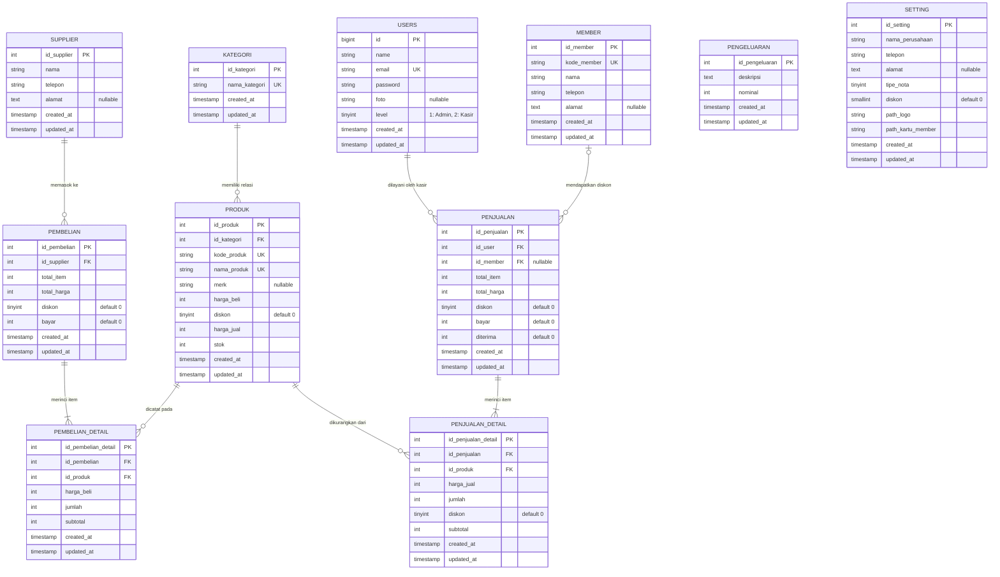
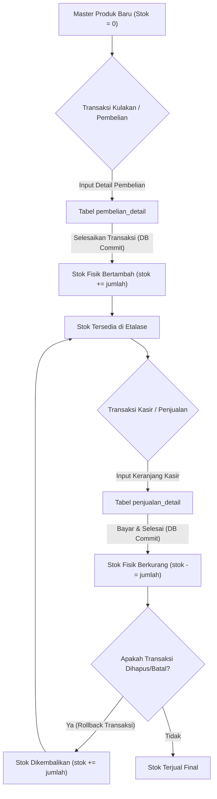
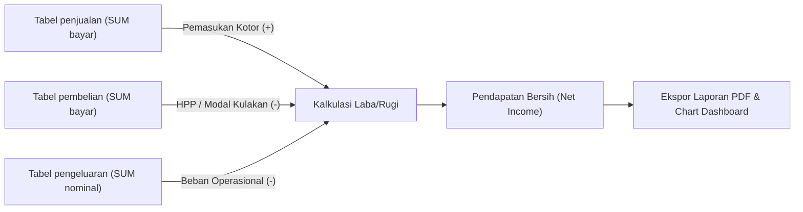
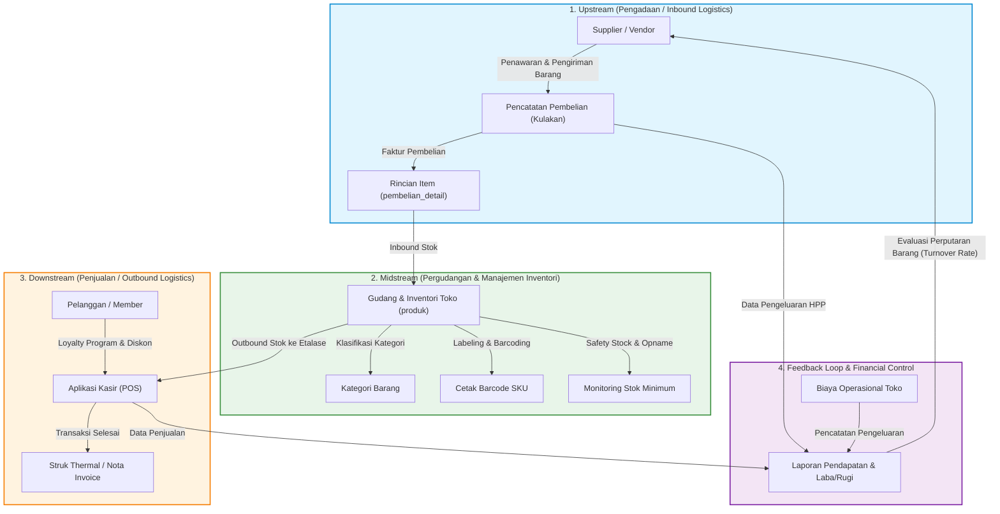

<p align="center">
  
</p>

<h1 align="center">Point of Sale (POS) - Laravel 8</h1>

<p align="center">
  <a href="#"></a>
  <a href="#"></a>
  <a href="#"></a>
  <a href="#"></a>
  <a href="#"></a>
</p>

---

## 📋 Daftar Isi
1. [Tentang Sistem](#-tentang-sistem)
2. [Fitur Utama](#-fitur-utama)
3. [Entity Relationship Diagram (ERD)](#-entity-relationship-diagram-erd)
4. [Rotasi Alur Kerja Database](#-rotasi-alur-kerja-database)
5. [Supply Chain Management (SCM)](#-supply-chain-management-scm)
6. [Instalasi dan Konfigurasi](#-instalasi-dan-konfigurasi)
7. [Akun Bawaan (Default Seeder)](#-akun-bawaan-default-seeder)
8. [Struktur Direktori Proyek](#-struktur-direktori-proyek)
9. [Kontributor & Lisensi](#-kontributor--lisensi)

---

## 📌 Tentang Sistem

**Point of Sale (POS) Laravel 8** adalah aplikasi sistem kasir dan manajemen ritel modern yang dirancang untuk mengelola inventori produk, transaksi pengadaan barang (pembelian dari supplier), transaksi kasir (penjualan ke konsumen/member), pencatatan biaya operasional, serta agregasi laporan keuangan (laba/rugi) secara akurat dan otomatis.

Aplikasi dibangun menggunakan:
- **Framework:** Laravel 8 (mendukung PHP 7.4 hingga PHP 8.x)
- **Database Engine:** MySQL / MariaDB (InnoDB dengan Foreign Key Integrity)
- **Frontend & UI:** AdminLTE 2, Bootstrap 3, DataTables Server-Side (Yajra), Chart.js
- **Reporting Engine:** Barryvdh Laravel-DomPDF (Cetak Struk Thermal 75mm, Nota Invoice Besar A4, Kartu Member, dan Barcode SKU)

---

## 🚀 Fitur Utama

- **Dashboard Interaktif:** Grafik omset laba bersih harian berbasis ChartJS, counter total kategori, produk, supplier, dan member.
- **Manajemen Master Data:**
  - Kategori produk & data master barang (SKU/Kode Produk, Harga Beli, Harga Jual, Diskon, Stok).
  - Cetak label barcode produk massal.
  - Multi-delete produk terpilih.
  - Manajemen data member pelanggan & cetak kartu member instan (PDF layout 2-kolom).
  - Manajemen data supplier/vendor pemasok.
- **Modul Transaksi Point of Sale (Kasir):**
  - Antarmuka kasir cepat (shortcut keyboard, scan barcode/SKU).
  - Kalkulasi diskon otomatis (diskon barang & diskon membership).
  - Cetak struk kasir kecil (Thermal Printer 75mm) atau nota faktur besar (PDF).
  - Transaksi aman dengan ACID *Database Transaction* (mencegah data stok tidak sinkron).
- **Modul Pengadaan & Pembelian (Restock):**
  - Pemilihan supplier dan restock multi-item barang.
  - Sinkronisasi otomatis stok gudang saat transaksi kulakan diselesaikan atau dibatalkan.
- **Beban & Biaya Operasional:**
  - Pencatatan pengeluaran harian toko (listrik, gaji, operasional kasir, dll).
- **Laporan Keuangan (Laba & Rugi):**
  - Perhitungan otomatis: `Pendapatan Bersih = Total Penjualan - Total Pembelian - Total Pengeluaran`.
  - Filter laporan kustom berdasarkan rentang tanggal (`tanggal_awal` s.d `tanggal_akhir`) serta ekspor ke PDF.
- **Role & Hak Akses:**
  - **Level 1 (Administrator):** Akses penuh ke seluruh menu, laporan, master data, user, dan pengaturan toko.
  - **Level 2 (Kasir):** Akses khusus operasional transaksi penjualan aktif dan cetak nota.

---

## 🗄️ Entity Relationship Diagram (ERD)

Berikut adalah diagram relasi entitas basis data sistem:



---

## 🔄 Rotasi Alur Kerja Database

Rotasi alur kerja basis data menjelaskan siklus hidup (*lifecycle*), mutasi status data, serta perputaran stok dan keuangan yang terjadi di dalam tabel database.

### 1. Rotasi Siklus Mutasi Stok Barang (Stock Movement Cycle)



### 2. Rotasi Siklus Transaksi Penjualan Kasir (POS Lifecycle)

| Tahap | Status Tabel Database | Tindakan Sistem |
| :--- | :--- | :--- |
| **1. Inisiasi** | Record baru di `penjualan` dibuat dengan `total_item = 0`, `bayar = 0`, `id_user = auth()->id()`. | Menyimpan `session(['id_penjualan'])`. |
| **2. Scanning Item** | Record dimasukkan ke `penjualan_detail` (`id_penjualan`, `id_produk`, `harga_jual`, `jumlah = 1`). | Menghitung `subtotal = harga_jual * jumlah`. |
| **3. Update Kuantitas** | `jumlah` di `penjualan_detail` diupdate via Ajax. | Menghitung ulang akumulasi `total_harga` dan `total_item`. |
| **4. Validasi Member** | Jika member dipilih, diskon toko dari tabel `setting` diaplikasikan ke total bayar. | `diskon` dihitung, `bayar = total_harga - diskon`. |
| **5. Finalisasi Bayar** | `penjualan` diupdate (`bayar`, `diterima`, `total_item`). Semua `produk.stok` dipotong di dalam `DB::transaction()`. | Mengarahkan ke layar cetak nota (`transaksi.selesai`). |
| **6. Pembatalan Transaksi** | Jika nota dihapus, `DB::transaction()` mengembalikan `produk.stok += jumlah`, menghapus `penjualan_detail`, lalu menghapus `penjualan`. | Integritas stok kembali utuh tanpa selisih opname. |

### 3. Rotasi Siklus Laporan & Tutup Buku Finansial



---

## 🏭 Supply Chain Management (SCM)

Sistem mengadopsi prinsip rantai pasok terpadu (*Integrated Retail Supply Chain*) dari pemasok hingga ke tangan konsumen akhir:



### Penjelasan 4 Pilar Rantai Pasok:

1. **Upstream (Pengadaan Barang & Manajemen Vendor):**
   - Mengelola direktori vendor (`supplier`) terpercaya.
   - Melakukan restock berkala saat kuantitas barang menipis dengan mencatat `pembelian` dan `pembelian_detail`.
2. **Midstream (Manajemen Pergudangan & Nilai Persediaan):**
   - Menjaga akurasi stok fisik produk secara real-time.
   - Pemberian kode SKU / Barcode unik pada setiap item untuk mempercepat verifikasi fisik saat penerimaan barang.
   - Manajemen struktur katalog melalui pengelompokan `kategori`.
3. **Downstream (Distribusi & Kepuasan Pelanggan):**
   - Pemrosesan penjualan berkecepatan tinggi di meja kasir.
   - Program retensi pelanggan melalui identitas `member` dengan hak istimewa diskon khusus.
   - Fleksibilitas penerbitan bukti bayar: format ringkas *thermal roll 75mm* untuk ritel harian atau invoice kertas A4 untuk pesanan grosir.
4. **Analisis Finansial & Feedback Loop:**
   - Menyediakan wawasan perputaran barang (*inventory turnover*).
   - Analisis margin antara harga beli modal (`harga_beli`) dan harga jual toko (`harga_jual`).
   - Laporan laba bersih periodik sebagai dasar keputusan pemesanan ulang (*reorder point*) ke supplier.

---

## 💻 Instalasi dan Konfigurasi

### Prasyarat Sistem
- **PHP:** Versi `>= 7.4` atau `8.0` / `8.1` / `8.2`
- **Ekstensi PHP:** `BCMath`, `Ctype`, `Fileinfo`, `JSON`, `Mbstring`, `OpenSSL`, `PDO`, `pdo_mysql`, `Tokenizer`, `XML`, `GD` (untuk barcode/gambar)
- **Database:** MySQL `>= 5.7` atau MariaDB `>= 10.3`
- **Composer:** Versi `>= 2.x`

### Langkah-langkah Setup

1. **Clone repositori:**
   ```bash
   git clone https://github.com/bagussatoto/Point-Of-Sale-Laravel-8.git
   cd Point-Of-Sale-Laravel-8
   ```

2. **Install dependensi PHP via Composer:**
   ```bash
   composer install
   ```

3. **Buat file environment `.env`:**
   ```bash
   cp .env.example .env
   ```

4. **Konfigurasikan database pada file `.env`:**
   ```env
   DB_CONNECTION=mysql
   DB_HOST=127.0.0.1
   DB_PORT=3306
   DB_DATABASE=pos_laravel8
   DB_USERNAME=root
   DB_PASSWORD=
   ```

5. **Generate Application Key:**
   ```bash
   php artisan key:generate
   ```

6. **Jalankan migrasi tabel dan seeding data awal:**
   ```bash
   php artisan migrate --seed
   ```

7. **Hubungkan storage publik:**
   ```bash
   php artisan storage:link
   ```

8. **Jalankan server pengembangan:**
   ```bash
   php artisan serve
   ```
   Akses aplikasi di browser pada alamat: **`http://127.0.0.1:8000`**

---

## 🔑 Akun Bawaan (Default Seeder)

Setelah menjalankan `php artisan migrate --seed`, Anda dapat langsung login menggunakan akun berikut:

| Peran (Role) | Email | Password | Akses Menu |
| :--- | :--- | :--- | :--- |
| **Administrator** | `admin@gmail.com` | `123` | Seluruh Modul (Master Data, Transaksi, Laporan, Pengaturan Toko, User) |
| **Kasir** | `kasir1@gmail.com` | `123` | Dashboard Kasir, Transaksi Penjualan Baru, Transaksi Aktif |

---

## 📂 Struktur Direktori Proyek

```text
Point-Of-Sale-Laravel-8/
├── app/
│   ├── Http/
│   │   ├── Controllers/       # Kontroler logika sistem POS & laporan
│   │   ├── Helpers/           # Fungsi helper (format_uang, terbilang, tanggal_indonesia)
│   │   └── Middleware/        # Middleware autentikasi & pengecekan level akun (CekLevel)
│   └── Models/                # Model Eloquent (Produk, Penjualan, Pembelian, dll)
├── config/                    # Konfigurasi sistem (database, datatables, dompdf)
├── database/
│   ├── migrations/            # Skema tabel basis data
│   └── seeders/               # Data awal (SettingTableSeeder, UserTableSeeder)
├── docs/                      # Dokumentasi teknis & skema DBML
│   ├── ERD.md
│   └── schema.dbml
├── public/                    # Aset web publik (CSS, JS, gambar logo, kartu member)
├── resources/
│   └── views/                 # Template Blade (AdminLTE layout, master, kasir, transaksi)
├── routes/
│   └── web.php                # Definisi routing aplikasi
└── storage/                   # File log, cache, dan session framework
```

---

## 👨‍💻 Kontributor & Lisensi

Aplikasi ini dikembangkan dan dirancang oleh:

**Bagus Budi Satoto**
- **GitHub:** [@bagussatoto](https://github.com/bagussatoto)
- **Email:** [bagusbudi1308@gmail.com](mailto:bagusbudi1308@gmail.com)
- **Instagram:** [@bagus_satoto1](https://www.instagram.com/bagus_satoto1/)

---

Aplikasi ini dilisensikan di bawah lisensi terbuka [MIT License](LICENSE). Bebas digunakan, dipelajari, dan dikembangkan untuk keperluan komersial maupun edukasi.
