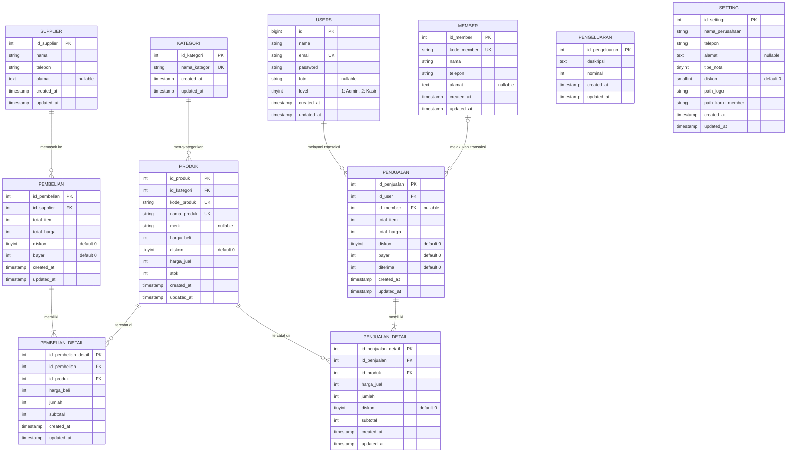

# Entity Relationship Diagram (ERD) - Point of Sale (POS) Laravel 8

Dokumen ini berisi spesifikasi skema basis data, diagram relasi entitas (ERD), kamus data, serta rekomendasi optimasi untuk sistem Point of Sale (POS).

---

## 1. Diagram Relasi Entitas (Mermaid ERD)

---

## 2. Kamus Data (Data Dictionary)

### 2.1. Tabel `kategori`
Menyimpan klasifikasi/kategori produk dagangan.

| Nama Kolom | Tipe Data | Nullable | Keterangan |
| :--- | :--- | :--- | :--- |
| `id_kategori` | `INT UNSIGNED` | No | Primary Key, Auto Increment |
| `nama_kategori` | `VARCHAR(255)` | No | Nama kategori (Unique) |
| `created_at` | `TIMESTAMP` | Yes | Waktu dibuat |
| `updated_at` | `TIMESTAMP` | Yes | Waktu terakhir diubah |

---

### 2.2. Tabel `produk`
Menyimpan data master item/barang dagangan.

| Nama Kolom | Tipe Data | Nullable | Keterangan |
| :--- | :--- | :--- | :--- |
| `id_produk` | `INT UNSIGNED` | No | Primary Key, Auto Increment |
| `id_kategori` | `INT UNSIGNED` | No | Foreign Key merujuk ke `kategori(id_kategori)` |
| `kode_produk` | `VARCHAR(255)` | No | Kode SKU / Barcode produk (Unique) |
| `nama_produk` | `VARCHAR(255)` | No | Nama barang (Unique) |
| `merk` | `VARCHAR(255)` | Yes | Brand/Merk produk |
| `harga_beli` | `INT` | No | Harga modal beli satuan |
| `diskon` | `TINYINT` | No | Persentase diskon produk (Default: 0) |
| `harga_jual` | `INT` | No | Harga jual per unit |
| `stok` | `INT` | No | Jumlah stok fisik barang |
| `created_at` | `TIMESTAMP` | Yes | Waktu dibuat |
| `updated_at` | `TIMESTAMP` | Yes | Waktu terakhir diubah |

---

### 2.3. Tabel `member`
Menyimpan data pelanggan/anggota member toko untuk potongan diskon.

| Nama Kolom | Tipe Data | Nullable | Keterangan |
| :--- | :--- | :--- | :--- |
| `id_member` | `INT UNSIGNED` | No | Primary Key, Auto Increment |
| `kode_member` | `VARCHAR(255)` | No | Nomor/ID kartu member (Unique) |
| `nama` | `VARCHAR(255)` | No | Nama lengkap member |
| `telepon` | `VARCHAR(255)` | No | Nomor kontak telepon/WhatsApp |
| `alamat` | `TEXT` | Yes | Alamat tinggal member |
| `created_at` | `TIMESTAMP` | Yes | Waktu dibuat |
| `updated_at` | `TIMESTAMP` | Yes | Waktu terakhir diubah |

---

### 2.4. Tabel `supplier`
Menyimpan data pemasok produk untuk transaksi pembelian / restock.

| Nama Kolom | Tipe Data | Nullable | Keterangan |
| :--- | :--- | :--- | :--- |
| `id_supplier` | `INT UNSIGNED` | No | Primary Key, Auto Increment |
| `nama` | `VARCHAR(255)` | No | Nama vendor/supplier |
| `telepon` | `VARCHAR(255)` | No | Nomor kontak supplier |
| `alamat` | `TEXT` | Yes | Alamat kantor/gudang supplier |
| `created_at` | `TIMESTAMP` | Yes | Waktu dibuat |
| `updated_at` | `TIMESTAMP` | Yes | Waktu terakhir diubah |

---

### 2.5. Tabel `users`
Menyimpan akun pengguna sistem POS (Admin dan Kasir).

| Nama Kolom | Tipe Data | Nullable | Keterangan |
| :--- | :--- | :--- | :--- |
| `id` | `BIGINT UNSIGNED` | No | Primary Key, Auto Increment |
| `name` | `VARCHAR(255)` | No | Nama staf/pengguna |
| `email` | `VARCHAR(255)` | No | Email login (Unique) |
| `password` | `VARCHAR(255)` | No | Hash bcrypt kata sandi |
| `foto` | `VARCHAR(255)` | Yes | Path foto profil staf |
| `level` | `TINYINT` | No | Hak akses (`1`: Admin, `2`: Kasir) |
| `created_at` | `TIMESTAMP` | Yes | Waktu dibuat |
| `updated_at` | `TIMESTAMP` | Yes | Waktu terakhir diubah |

---

### 2.6. Tabel `pembelian`
Menyimpan data transaksi nota kulakan barang dari supplier.

| Nama Kolom | Tipe Data | Nullable | Keterangan |
| :--- | :--- | :--- | :--- |
| `id_pembelian` | `INT UNSIGNED` | No | Primary Key, Auto Increment |
| `id_supplier` | `INT` | No | Relasi ke `supplier(id_supplier)` |
| `total_item` | `INT` | No | Total kuantitas barang kulakan |
| `total_harga` | `INT` | No | Total tagihan kotor sebelum diskon |
| `diskon` | `TINYINT` | No | Persentase diskon transaksi (Default: 0) |
| `bayar` | `INT` | No | Total nominal bersih yang dibayarkan |
| `created_at` | `TIMESTAMP` | Yes | Waktu transaksi pembelian |
| `updated_at` | `TIMESTAMP` | Yes | Waktu terakhir diubah |

---

### 2.7. Tabel `pembelian_detail`
Menyimpan item barang dari nota transaksi pembelian.

| Nama Kolom | Tipe Data | Nullable | Keterangan |
| :--- | :--- | :--- | :--- |
| `id_pembelian_detail` | `INT UNSIGNED` | No | Primary Key, Auto Increment |
| `id_pembelian` | `INT` | No | Relasi ke `pembelian(id_pembelian)` |
| `id_produk` | `INT` | No | Relasi ke `produk(id_produk)` |
| `harga_beli` | `INT` | No | Harga beli satuan saat transaksi |
| `jumlah` | `INT` | No | Jumlah unit barang yang dibeli |
| `subtotal` | `INT` | No | Total harga (`harga_beli * jumlah`) |
| `created_at` | `TIMESTAMP` | Yes | Waktu dibuat |
| `updated_at` | `TIMESTAMP` | Yes | Waktu terakhir diubah |

---

### 2.8. Tabel `penjualan`
Menyimpan data transaksi kasir penjualan ke pelanggan.

| Nama Kolom | Tipe Data | Nullable | Keterangan |
| :--- | :--- | :--- | :--- |
| `id_penjualan` | `INT UNSIGNED` | No | Primary Key, Auto Increment |
| `id_user` | `INT` | No | Relasi ke `users(id)` (Kasir yang bertugas) |
| `id_member` | `INT` | Yes | Relasi ke `member(id_member)` (Opsional/Null jika umum) |
| `total_item` | `INT` | No | Total jumlah barang yang dibeli |
| `total_harga` | `INT` | No | Total harga kotor |
| `diskon` | `TINYINT` | No | Persentase diskon tambahan (Default: 0) |
| `bayar` | `INT` | No | Total tagihan bersih setelah diskon |
| `diterima` | `INT` | No | Uang tunai yang diserahkan konsumen |
| `created_at` | `TIMESTAMP` | Yes | Waktu transaksi penjualan |
| `updated_at` | `TIMESTAMP` | Yes | Waktu terakhir diubah |

---

### 2.9. Tabel `penjualan_detail`
Menyimpan rincian item barang pada setiap transaksi penjualan kasir.

| Nama Kolom | Tipe Data | Nullable | Keterangan |
| :--- | :--- | :--- | :--- |
| `id_penjualan_detail` | `INT UNSIGNED` | No | Primary Key, Auto Increment |
| `id_penjualan` | `INT` | No | Relasi ke `penjualan(id_penjualan)` |
| `id_produk` | `INT` | No | Relasi ke `produk(id_produk)` |
| `harga_jual` | `INT` | No | Harga jual satuan saat transaksi |
| `jumlah` | `INT` | No | Kuantitas barang yang terjual |
| `diskon` | `TINYINT` | No | Diskon per item (Default: 0) |
| `subtotal` | `INT` | No | Nilai subtotal item |
| `created_at` | `TIMESTAMP` | Yes | Waktu dibuat |
| `updated_at` | `TIMESTAMP` | Yes | Waktu terakhir diubah |

---

### 2.10. Tabel `pengeluaran`
Menyimpan pencatatan pengeluaran operasional toko (listrik, gaji, operasional kasir, dll).

| Nama Kolom | Tipe Data | Nullable | Keterangan |
| :--- | :--- | :--- | :--- |
| `id_pengeluaran` | `INT UNSIGNED` | No | Primary Key, Auto Increment |
| `deskripsi` | `TEXT` | No | Keterangan peruntukan pengeluaran |
| `nominal` | `INT` | No | Jumlah uang yang dikeluarkan |
| `created_at` | `TIMESTAMP` | Yes | Waktu pencatatan pengeluaran |
| `updated_at` | `TIMESTAMP` | Yes | Waktu terakhir diubah |

---

### 2.11. Tabel `setting`
Menyimpan preferensi toko, konfigurasi nota transaksi, serta aset visual.

| Nama Kolom | Tipe Data | Nullable | Keterangan |
| :--- | :--- | :--- | :--- |
| `id_setting` | `INT UNSIGNED` | No | Primary Key, Auto Increment |
| `nama_perusahaan` | `VARCHAR(255)` | No | Nama toko / bisnis POS |
| `telepon` | `VARCHAR(255)` | No | Kontak toko |
| `alamat` | `TEXT` | Yes | Alamat fisik toko |
| `tipe_nota` | `TINYINT` | No | Format struk (`1`: Nota Kecil/Thermal, `2`: Nota Besar/PDF) |
| `diskon` | `SMALLINT` | No | Standar diskon member toko dalam persen |
| `path_logo` | `VARCHAR(255)` | No | Path file gambar logo toko |
| `path_kartu_member`| `VARCHAR(255)` | No | Path desain latar belakang kartu member |
| `created_at` | `TIMESTAMP` | Yes | Waktu dibuat |
| `updated_at` | `TIMESTAMP` | Yes | Waktu terakhir diubah |

---

## 3. Catatan As-Is vs Rekomendasi Optimasi

Saat ini aplikasi menggunakan relasi berbasis logika kode (Eloquent ORM) dengan satu Foreign Key fisik di database: `produk.id_kategori -> kategori.id_kategori`.

Berikut rekomendasi peningkatan integritas referensial jika ingin diperkuat di level basis data MySQL:

1. **Tambahkan Foreign Key Fisik (ON DELETE CASCADE / RESTRICT)**
   - `pembelian_detail.id_pembelian` -> `pembelian.id_pembelian` (`ON DELETE CASCADE`)
   - `pembelian_detail.id_produk` -> `produk.id_produk` (`ON DELETE RESTRICT`)
   - `penjualan_detail.id_penjualan` -> `penjualan.id_penjualan` (`ON DELETE CASCADE`)
   - `penjualan_detail.id_produk` -> `produk.id_produk` (`ON DELETE RESTRICT`)
   - `penjualan.id_user` -> `users.id` (`ON DELETE RESTRICT`)
   - `penjualan.id_member` -> `member.id_member` (`ON DELETE SET NULL`)
   - `pembelian.id_supplier` -> `supplier.id_supplier` (`ON DELETE RESTRICT`)

2. **Konsistensi Tipe Data Primary Key & Foreign Key**
   - Kolom `users.id` bertipe `BIGINT UNSIGNED`, sedangkan kolom `penjualan.id_user` saat ini didefinisikan sebagai `INT`. Disarankan mengubah `penjualan.id_user` menjadi `BIGINT UNSIGNED` agar kompatibel untuk constraint Foreign Key.
   - Kolom relasi seperti `id_supplier`, `id_pembelian`, `id_penjualan` disarankan menggunakan `UNSIGNED INT` agar seragam dengan kolom `increments()` tabel target.

3. **Indeks Performa (Indexing)**
   - Menambahkan index pada `penjualan.created_at` dan `pembelian.created_at` untuk mempercepat query laporan harian, bulanan, dan rentang tanggal kustom.
