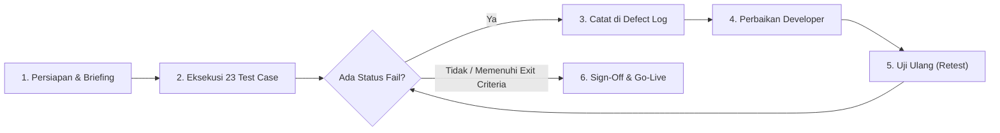

# Dokumen User Acceptance Testing (UAT) — Point of Sale (POS) Laravel 8

Dokumen ini digunakan sebagai panduan pengujian penerimaan pengguna (*User Acceptance Testing*) untuk memastikan seluruh fitur, integritas stok, kalkulasi keuangan, hak akses, dan keamanan pada aplikasi **Point of Sale (POS) Laravel 8** berjalan sesuai kebutuhan bisnis sebelum digunakan di lingkungan produksi.

---

## 📋 1. Informasi Pengujian

| Keterangan | Detail |
| :--- | :--- |
| **Nama Sistem** | Point of Sale (POS) Laravel 8 |
| **Versi / Release** | `v1.1.0` |
| **Tanggal Uji** | `____ / ____ / 202__` |
| **Penguji (Tester / Klien)** | `___________________________` |
| **Lingkungan Uji** | Localhost / Staging / Production |
| **Browser & Perangkat** | Chrome / Edge, Barcode Scanner USB, Printer Thermal 75mm (jika ada) |

### Akun Pengujian Default (Hasil Seeder)
| Role | Email | Password | Level |
| :--- | :--- | :--- | :---: |
| **Administrator** | `admin@gmail.com` | `123` | `1` |
| **Kasir** | `kasir1@gmail.com` | `123` | `2` |

---

## 🛠️ 2. Prosedur Penerapan UAT (SOP & Kriteria Kelulusan)

### 2.1. Prasyarat Sebelum UAT (*Entry Criteria*)
Sebelum pengujian dimulai, pastikan lingkungan uji memenuhi syarat berikut:
1. Aplikasi berjalan pada environment *staging* atau lokal dengan database bersih hasil migrasi dan seeder (`php artisan migrate:fresh --seed`).
2. Minimal tersedia 2 data Kategori, 3 data Produk, 1 Supplier, dan 1 Member sebagai data uji awal.
3. Perangkat keras toko (jika digunakan di produksi) seperti *barcode scanner* USB dan *printer thermal 75mm* sudah terhubung ke komputer kasir.

### 2.2. Peran & Tanggung Jawab
| Peran | Pihak Terkait | Tugas Utama |
| :--- | :--- | :--- |
| **Fasilitator UAT** | Developer / Tim Teknis | Menyiapkan server & database uji, memantau log error (`storage/logs/laravel.log`), dan memperbaiki bug yang ditemukan. |
| **Penguji (*Tester*)** | Pemilik Toko / Admin / Kasir | Menjalankan seluruh skenario uji sesuai alur kerja toko nyata dan menentukan status **Pass** atau **Fail**. |

### 2.3. Alur Pelaksanaan (*Execution Workflow*)

### 2.4. Klasifikasi Bug (*Severity*) & Kriteria Lulus (*Exit Criteria*)
| Tingkat Keparahan | Definisi & Contoh Kasus | Syarat Kelulusan (*Exit Criteria*) |
| :--- | :--- | :--- |
| **Critical / Blocker** | Aplikasi crash (500), stok produk tidak sinkron, salah hitung bayar/kembalian, nota gagal cetak. | **Wajib 0 bug** sebelum Go-Live. |
| **Major** | Fitur berjalan namun ada validasi penting yang terlewat atau tampilan data tidak akurat. | Wajib diperbaiki sebelum *Sign-Off* final. |
| **Minor / Cosmetic** | Salah ketik teks label ringan atau margin tampilan sedikit bergeser tanpa mengganggu fungsi. | Boleh *Approved with Minor Notes* (diperbaiki di patch berikutnya). |

---

## 🧪 3. Skenario Pengujian (Test Cases)

### A. Autentikasi, Dashboard & Hak Akses (`CekLevel`)

| ID | Skenario Uji | Langkah Pengujian | Hasil yang Diharapkan | Status (Pass/Fail) | Catatan |
| :--- | :--- | :--- | :--- | :---: | :--- |
| **UAT-01** | Login Administrator | 1. Buka `/login` 2. Masukkan akun Admin (`admin@gmail.com` / `123`) | Berhasil masuk ke `/dashboard`, tampil counter Kategori, Produk, Supplier, Member, dan grafik pendapatan ChartJS tanpa error. | `[ ] Pass` / `[ ] Fail` | |
| **UAT-02** | Login Kasir | 1. Logout 2. Login dengan akun Kasir (`kasir1@gmail.com` / `123`) | Masuk ke dashboard kasir; sidebar hanya menampilkan menu `Dashboard`, `Transaksi Aktif`, `Transaksi Baru`, dan `Profil`. | `[ ] Pass` / `[ ] Fail` | |
| **UAT-03** | Pembatasan Akses Kasir | Saat login sebagai Kasir, ketik manual URL `/produk`, `/laporan`, atau `/user` di browser | Sistem otomatis mengalihkan (redirect) ke `/dashboard` dan tidak membuka halaman Admin. | `[ ] Pass` / `[ ] Fail` | |

---

### B. Master Data (Kategori, Produk, Member, Supplier)

| ID | Skenario Uji | Langkah Pengujian | Hasil yang Diharapkan | Status (Pass/Fail) | Catatan |
| :--- | :--- | :--- | :--- | :---: | :--- |
| **UAT-04** | Tambah & Edit Kategori | 1. Buka `/kategori` 2. Tambah kategori baru, lalu edit namanya | Data tersimpan dan tabel DataTables langsung ter-refresh menampilkan data terbaru. | `[ ] Pass` / `[ ] Fail` | |
| **UAT-05** | Tambah Produk & Auto-SKU | 1. Buka `/produk` 2. Tambah produk (pilih kategori, harga beli, harga jual, diskon, stok awal) | Produk tersimpan dengan `kode_produk` otomatis format `P000001`, dst. | `[ ] Pass` / `[ ] Fail` | |
| **UAT-06** | Proteksi Hapus Kategori Terpakai | Coba hapus Kategori yang sedang digunakan oleh minimal 1 Produk | Sistem menolak penghapusan (HTTP 422) dengan pesan peringatan dan tidak terjadi error 500. | `[ ] Pass` / `[ ] Fail` | |
| **UAT-07** | Cetak Barcode Massal (Valid & Kosong) | 1. Klik **Cetak Barcode** tanpa mencentang produk 2. Centang >= 1 produk lalu klik **Cetak Barcode** | 1. Tidak crash (*TypeError*), halaman kembali normal. 2. Terbuka PDF barcode ukuran A4 portrait berisi kode & nama produk terpilih. | `[ ] Pass` / `[ ] Fail` | |
| **UAT-08** | Hapus Produk Terpilih (`Delete Selected`) | 1. Klik **Hapus** tanpa centang 2. Centang beberapa produk lalu klik **Hapus** | 1. Tidak crash. 2. Produk yang dicentang terhapus dari tabel. | `[ ] Pass` / `[ ] Fail` | |
| **UAT-09** | Manajemen Member & Cetak Kartu | 1. Buka `/member`, tambah member baru 2. Uji cetak kartu tanpa centang & dengan centang member | `kode_member` ter-generate 5 digit (`00001`), dan PDF kartu member 2-kolom portrait ter-generate tanpa error. | `[ ] Pass` / `[ ] Fail` | |
| **UAT-10** | Manajemen Supplier | Buka `/supplier`, lakukan Tambah, Edit, dan Hapus supplier | Seluruh operasi CRUD berjalan normal tanpa error. | `[ ] Pass` / `[ ] Fail` | |

---

### C. Pengadaan / Pembelian & Mutasi Stok Masuk

| ID | Skenario Uji | Langkah Pengujian | Hasil yang Diharapkan | Status (Pass/Fail) | Catatan |
| :--- | :--- | :--- | :--- | :---: | :--- |
| **UAT-11** | Buat Transaksi Pembelian | 1. Buka `/pembelian`, klik **Transaksi Baru** dan pilih Supplier 2. Tambah produk, ubah jumlah (`quantity`) menjadi `10`, isi diskon (opsional) 3. Klik **Simpan Transaksi** | Transaksi tersimpan di `/pembelian`, nama supplier tampil benar, dan **stok produk di `/produk` bertambah `10`**. | `[ ] Pass` / `[ ] Fail` | |
| **UAT-12** | Lihat Detail & Hapus Pembelian | 1. Klik tombol detail (ikon mata) pada transaksi pembelian 2. Klik tombol hapus pada transaksi pembelian tersebut | 1. Modal detail menampilkan daftar item beli. 2. Setelah dihapus, **stok produk otomatis berkurang kembali `10`**. | `[ ] Pass` / `[ ] Fail` | |

---

### D. Transaksi Kasir (Point of Sale) & Cetak Struk

| ID | Skenario Uji | Langkah Pengujian | Hasil yang Diharapkan | Status (Pass/Fail) | Catatan |
| :--- | :--- | :--- | :--- | :---: | :--- |
| **UAT-13** | Akses Transaksi Aktif Tanpa Sesi | Login sebagai Kasir (sesi baru/kosong), klik menu **Transaksi Aktif** | Otomatis diarahkan ke `/transaksi/baru` (tidak muncul error `Route [home] not defined`). | `[ ] Pass` / `[ ] Fail` | |
| **UAT-14** | Input Item & Hitung Total Kasir | 1. Buka `/transaksi/baru` 2. Pilih atau scan produk 3. Ubah kuantitas menjadi `2` | Subtotal, total harga, total item, dan teks terbilang otomatis terhitung akurat. | `[ ] Pass` / `[ ] Fail` | |
| **UAT-15** | Penerapan Diskon Member | Pada transaksi kasir, pilih salah satu **Member** | Diskon otomatis terisi sesuai pengaturan toko (`setting.diskon`, default `5%`) dan total bayar terpotong. | `[ ] Pass` / `[ ] Fail` | |
| **UAT-16** | Simpan Penjualan & Pengurangan Stok | 1. Masukkan nominal uang **Diterima** >= **Bayar** 2. Cek nilai **Kembali** 3. Klik **Simpan Transaksi** | Diarahkan ke halaman transaksi selesai (`/transaksi/selesai`), dan **stok produk di `/produk` berkurang `2`**. | `[ ] Pass` / `[ ] Fail` | |
| **UAT-17** | Cetak Nota Kecil (Thermal 75mm) | Pada halaman transaksi selesai, klik **Cetak Ulang Nota** (ketika setting `tipe_nota = 1`) | Jendela pop-up `/transaksi/nota-kecil` tampil rapi (nama toko, kasir, item, total, diterima, kembali) dan siap cetak ke printer thermal. | `[ ] Pass` / `[ ] Fail` | |
| **UAT-18** | Cetak Nota Besar (PDF Invoice) | Ubah `tipe_nota = 2` di Pengaturan, lalu cetak ulang nota transaksi | File PDF `/transaksi/nota-besar` terbuka sempurna dengan ukuran `[0, 0, 609, 440]` portrait tanpa error DomPDF. | `[ ] Pass` / `[ ] Fail` | |
| **UAT-19** | Hapus Riwayat Penjualan | Di `/penjualan` (Admin), lihat detail transaksi lalu hapus transaksi | Detail tampil normal; saat dihapus, **stok produk kembali bertambah** sesuai jumlah item transaksi. | `[ ] Pass` / `[ ] Fail` | |

---

### E. Pengeluaran, Laporan Keuangan & Pengaturan

| ID | Skenario Uji | Langkah Pengujian | Hasil yang Diharapkan | Status (Pass/Fail) | Catatan |
| :--- | :--- | :--- | :--- | :---: | :--- |
| **UAT-20** | Catat Pengeluaran | Buka `/pengeluaran`, tambah pengeluaran operasional (misal Listrik `Rp 100.000`) | Data tersimpan dengan format tanggal Indonesia dan nominal rupiah yang benar. | `[ ] Pass` / `[ ] Fail` | |
| **UAT-21** | Laporan Laba/Rugi & Ekspor PDF | 1. Buka `/laporan`, ubah periode tanggal ke hari ini 2. Klik **Export PDF** | Nilai `Pendapatan = Penjualan - Pembelian - Pengeluaran` akurat, dan PDF laporan terunduh dalam format A4 portrait. | `[ ] Pass` / `[ ] Fail` | |
| **UAT-22** | Pengaturan Toko & Validasi Upload | 1. Buka `/setting`, ubah nama toko dan upload file `.php`/`.txt` ke logo 2. Upload file gambar `.png`/`.jpg` (< 2MB) | 1. File non-gambar ditolak oleh validasi (tidak masuk ke `public/img`). 2. Gambar valid tersimpan dan logo toko berubah. | `[ ] Pass` / `[ ] Fail` | |
| **UAT-23** | Manajemen User & Proteksi Akun Sendiri | 1. Buka `/user`, tambah kasir baru & update profil sendiri 2. Uji upload foto non-gambar di `/profil` | Kasir baru dapat login; file non-gambar ditolak; admin tidak bisa menghapus akun miliknya sendiri. | `[ ] Pass` / `[ ] Fail` | |

---

## 🐛 4. Log Temuan Bug (*Defect Report Log*)

Isi tabel di bawah ini apabila terdapat skenario uji yang berstatus **Fail**:

| No | ID Test Case | Deskripsi Masalah / Error | Tingkat Keparahan (*Severity*) | Bukti / Screenshot | Status Perbaikan |
| :-: | :--- | :--- | :--- | :--- | :--- |
| 1 | `UAT-__` | | `Critical / Major / Minor` | | `Open / Fixed / Retested` |
| 2 | `UAT-__` | | `Critical / Major / Minor` | | `Open / Fixed / Retested` |
| 3 | `UAT-__` | | `Critical / Major / Minor` | | `Open / Fixed / Retested` |

---

## 📝 5. Ringkasan Hasil & Persetujuan (*Sign-Off*)

| Ringkasan | Jumlah |
| :--- | :---: |
| Total Skenario Uji | **23** |
| Jumlah **Pass** | `_____` |
| Jumlah **Fail** | `_____` |

### Keputusan Akhir:
- `[ ]` **DITERIMA (Approved)** — Aplikasi siap digunakan di lingkungan produksi / operasional toko.
- `[ ]` **DITERIMA DENGAN CATATAN (Approved with Minor Notes)** — Layak rilis dengan daftar perbaikan minor terlampir.
- `[ ]` **DITOLAK (Rejected)** — Terdapat bug kritis (*blocker*) yang harus diperbaiki sebelum rilis ulang.

| Disiapkan Oleh (Developer) | Diperiksa & Disetujui Oleh (Pengguna / Klien) |
| :--- | :--- |
| Nama: ________________________ | Nama: ________________________ |
| Tanggal: _____________________ | Tanggal: _____________________ |
| Tanda Tangan: | Tanda Tangan: |

